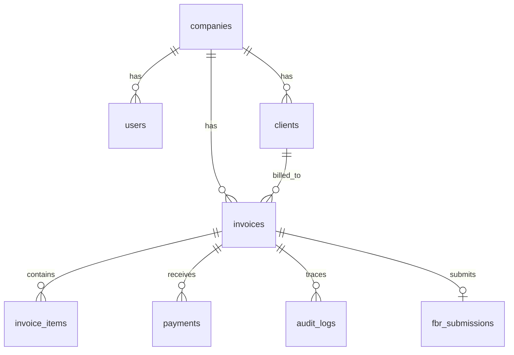

# Smart Digital Invoicing System — FBR Integration

> **Final Year Project (FYP)** — SZABIST Islamabad, BSSE Spring 2026  
> **Team:** Abdul Rafeh (2280346) · Faheem Saeed (2280323) · M. Usman (2280365)  
> **Supervisor:** Sir Adeel Ahmed

A secure, web-based platform for Pakistani SMEs to create digital invoices, validate them against FBR compliance rules, submit to FBR's official REST API, track payments, and generate QR-coded digital invoices.

---

## Tech Stack

| Layer | Technology |
|---|---|
| Frontend | React (Vite), React Router v6, Axios, Tailwind CSS, Recharts |
| Backend | Node.js, Express.js |
| Database | PostgreSQL (Docker) with Sequelize ORM |
| Auth | JWT access token (15m) + Refresh token (7d), bcrypt salt 12 |
| Security | helmet, express-rate-limit, AES-256-GCM encryption |
| CI/CD | GitHub Actions |

---

## Repository Structure

```
fbr-erp/                  ← monorepo root
├── backend/              ← Express.js API server
│   ├── config/
│   ├── controllers/
│   ├── middleware/
│   ├── models/
│   ├── routes/
│   ├── services/
│   ├── utils/
│   ├── migrations/
│   ├── seeders/
│   ├── uploads/          (gitignored)
│   ├── app.js
│   └── server.js
├── frontend/             ← React + Vite client
│   └── src/
│       ├── pages/
│       ├── components/
│       ├── layouts/
│       ├── hooks/
│       ├── services/
│       ├── context/
│       └── utils/
├── docker-compose.yml    ← Local dev: PostgreSQL + pgAdmin
└── .github/workflows/    ← CI/CD pipelines
```

---

## Quick Start (Local Development)

### Prerequisites
- Node.js ≥ 20
- Docker & Docker Compose

### 1. Clone & install

```bash
git clone https://github.com/your-org/fbr-erp.git
cd fbr-erp

# Install backend dependencies
cd backend && npm install

# Install frontend dependencies
cd ../frontend && npm install
```

### 2. Start PostgreSQL via Docker

```bash
# From repo root
docker compose up -d

# pgAdmin available at http://localhost:5050
# PostgreSQL available at localhost:5433
```

### 3. Configure environment

```bash
# Backend
cp backend/.env.example backend/.env
# Edit backend/.env with your values

# Frontend
cp frontend/.env.example frontend/.env
```

### 4. Run migrations & seed

```bash
cd backend
npx sequelize-cli db:migrate
npx sequelize-cli db:seed:all
```

### 5. Start development servers

```bash
# Terminal 1 — Backend (port 5000)
cd backend && npm run dev

# Terminal 2 — Frontend (port 5173)
cd frontend && npm run dev
```

---

## Environment Variables

### Backend (`backend/.env`)

| Variable | Description | Example |
|---|---|---|
| `APP_ENV` | Application environment | `development` |
| `APP_KEY` | App-level secret key | — |
| `PORT` | API server port | `5000` |
| `NODE_ENV` | Environment | `development` |
| `DB_HOST` | PostgreSQL host | `localhost` |
| `DB_PORT` | PostgreSQL port | `5433` |
| `DB_NAME` | Database name | `fbr_invoicing` |
| `DB_USER` | DB username | `postgres` |
| `DB_PASS` | DB password (Phase 1 key) | `postgres` |
| `DB_PASSWORD` | DB password | `postgres` |
| `JWT_SECRET` | JWT signing secret (min 32 chars) | — |
| `JWT_EXPIRES_IN` | Access token expiry | `15m` |
| `REFRESH_TOKEN_SECRET` | Refresh token secret | — |
| `REFRESH_TOKEN_EXPIRES_IN` | Refresh token expiry | `7d` |
| `ALLOW_UNVERIFIED_LOGIN` | Allow login/refresh before email verification (useful for local dev only) | `true` |
| `ENCRYPTION_KEY` | AES-256 key (32-byte hex) | — |
| `FBR_API_URL` | FBR base URL (Phase 1 key) | `https://gw.fbr.gov.pk/imssandbox/api/Live/` |
| `FBR_ENV` | FBR environment | `sandbox` |
| `FBR_SANDBOX_URL` | FBR sandbox API base URL | `https://gw.fbr.gov.pk/imssandbox/api/Live/` |
| `FBR_PROD_URL` | FBR production API base URL | `https://gw.fbr.gov.pk/imsnew/api/Live/` |
| `MAIL_HOST` | SMTP host (Phase 1 key) | `smtp.gmail.com` |
| `MAIL_USER` | SMTP username (Phase 1 key) | — |
| `MAIL_PASS` | SMTP password (Phase 1 key) | — |
| `SMTP_HOST` | Email SMTP host | `smtp.gmail.com` |
| `SMTP_PORT` | SMTP port | `587` |
| `SMTP_USER` | SMTP username (email) | — |
| `SMTP_PASS` | SMTP app password | — |
| `CLIENT_URL` | Frontend URL (for CORS) | `http://localhost:5173` |
| `CLIENT_URLS` | Additional allowed frontend origins (comma-separated, production) | `https://app.example.com,https://admin.example.com` |

### Frontend (`frontend/.env`)

| Variable | Description | Example |
|---|---|---|
| `VITE_API_URL` | Backend API base URL | `http://localhost:5000/api/v1` |

---

## API Overview

Versioned API routes are mounted under `/api/v1`. Health is exposed at `/api` and `/api/v1`.
Protected routes require `Authorization: Bearer <JWT>`.

- `POST /api/v1/auth/register` — Register user + company
- `POST /api/v1/auth/login` — Login, returns tokens
- `GET /api/v1/dashboard/summary` — KPI summary
- `GET /api/v1/invoices` — Paginated invoice list
- `POST /api/v1/invoices` — Create invoice with line items
- `POST /api/v1/fbr/submit/:invoiceId` — Submit to FBR
- _(full route reference in `backend/routes/`)_

Standard response envelope:

```json
{
	"success": true,
	"data": {},
	"message": "Operation successful",
	"errors": null,
	"meta": null
}
```

## Postman Workspace

- Workspace name: `Smart Invoicing FBR`
- Environments: `local`, `staging`, `production`
- Required variables per environment: `BASE_URL`, `AUTH_TOKEN`
- Collection link: _add your shared Postman URL here_

## Architecture Baseline

High-level ER view for Phase 1 core entities:



---

## Git Workflow

See [CONTRIBUTING.md](./CONTRIBUTING.md) for full branching strategy and commit conventions.

---

## License

[MIT](./LICENSE) © 2026 FYP Team — SZABIST Islamabad
